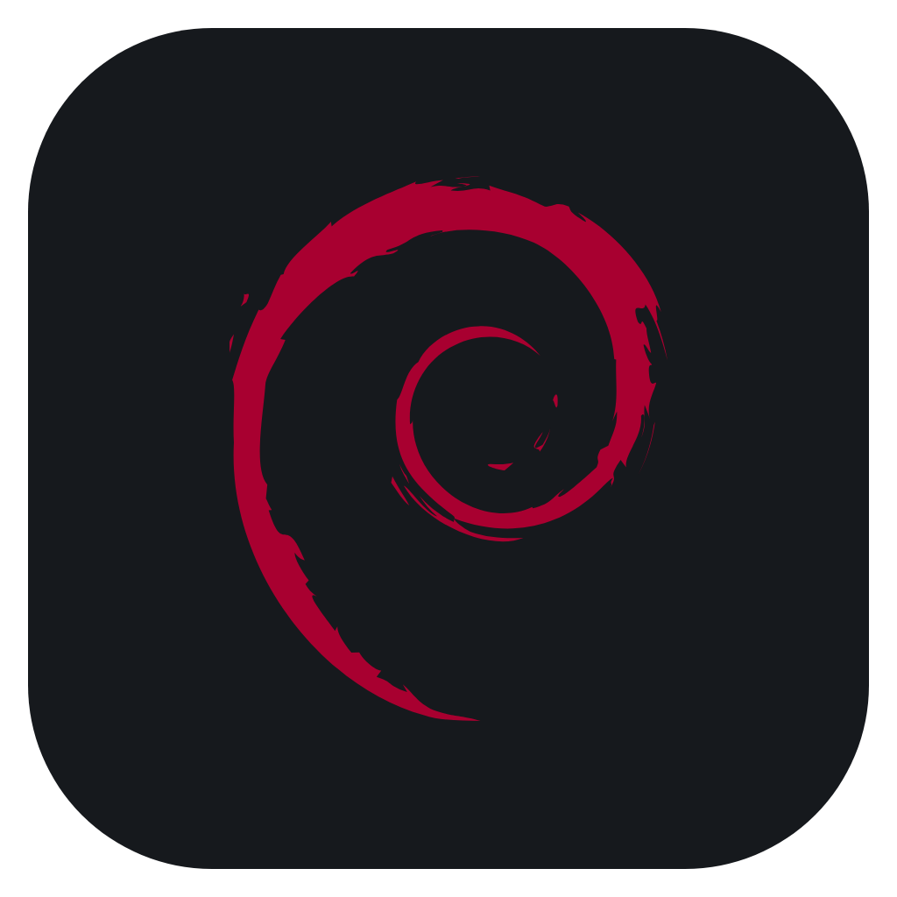
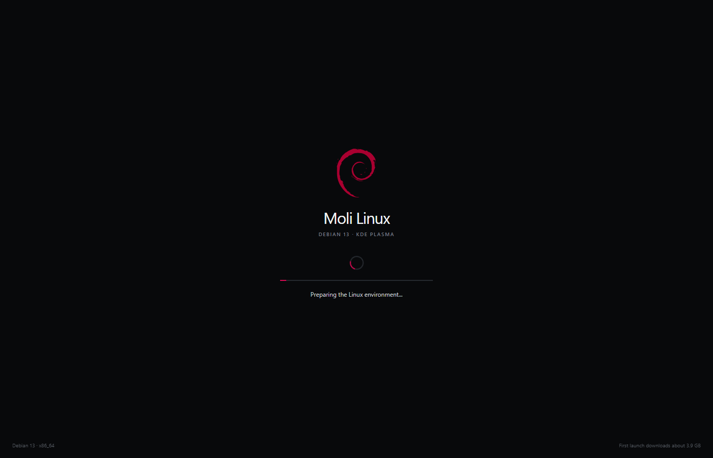
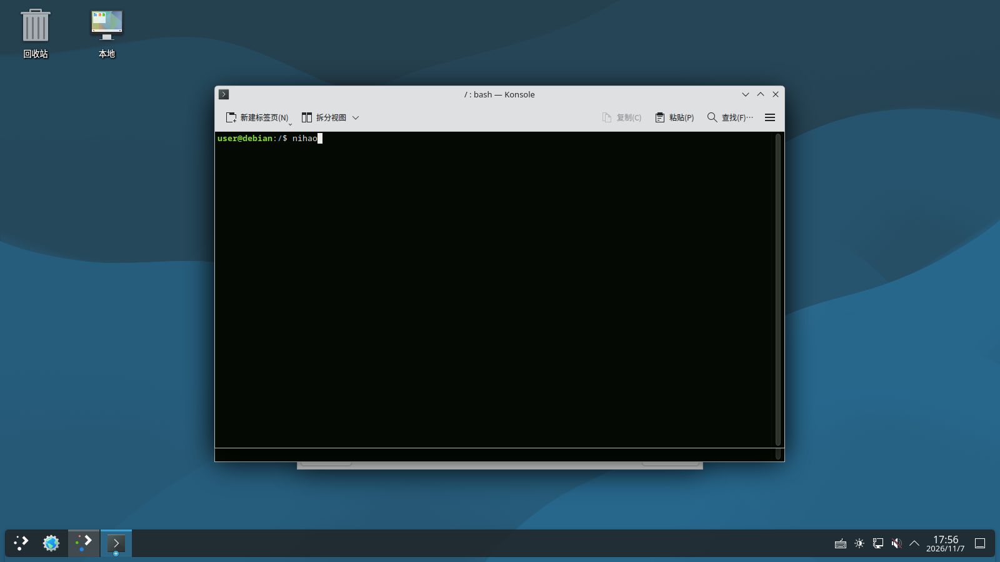
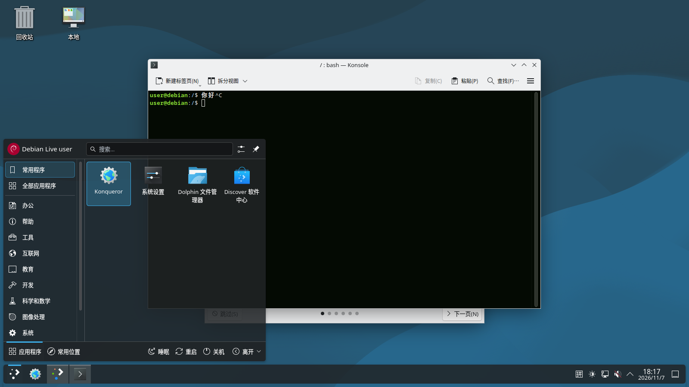
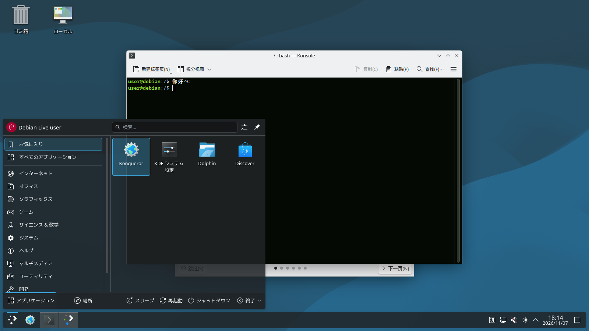

# Moli Linux



Moli Linux runs a real Debian 13 KDE desktop inside a dedicated Windows or
macOS application window. It is a complete local Linux workspace, not a
website mock-up: the guest system boots through QEMU, has persistent storage,
and can install and run normal Debian software.

## Screenshots

| Launch | Debian KDE desktop |
| --- | --- |
|  |  |

| Simplified Chinese | Japanese |
| --- | --- |
|  |  |

WSL is not required. Hyper-V or BIOS changes are not mandatory: Moli Linux uses
WHPX when virtualization is available and automatically falls back to QEMU TCG.

## What is included

- Debian 13.7 with KDE Plasma
- A native Electron window with maximize, full screen, and Developer Tools
- QEMU virtualization with WHPX on Windows and HVF where available on macOS
- Automatic software fallback when hardware virtualization is unavailable
- A persistent copy-on-write system disk
- Two disks by default: the Debian system disk and a 64 GiB sparse data disk
- The data disk mounted at `/home/user/Data` and linked from the desktop
- A shared folder between the host and guest at `Documents/MoliLinuxShare`
- English and Simplified Chinese interface switching
- Linux keyboard, mouse, audio, networking, and display integration

The 64 GiB data disk is sparse. It does not reserve 64 GiB immediately; its
host file only grows as data is written.

## Windows installation

The recommended method is to download only:

- `Moli-Linux-1.0.0-win-x64-Setup.exe`

When the installer was downloaded directly from the GitHub Release, it detects
the release URL, downloads the required payload parts automatically, verifies
their SHA-256 hashes, installs Moli Linux, and removes the temporary downloads.
This avoids the common mistake of downloading the EXE without the split payload
files. Allow at least 18 GB of temporary free space during this method.

Offline/manual method: download the Setup executable and every
`Moli-Linux-1.0.0-win-x64-payload.7z.001`, `.002`, `.003`, and `.004` file into
one folder, then run the Setup executable. The installer supports a custom
installation directory and creates desktop and Start menu shortcuts.

If a third-party download manager strips the browser's download-source marker,
use the offline/manual method.

Hardware virtualization is recommended. Moli Linux automatically tries WHPX
first and falls back to QEMU TCG when virtualization is unavailable. TCG works
without changing BIOS or Windows features, but startup and desktop performance
are significantly slower.

## macOS installation

Choose the package for the Mac:

- Apple Silicon: `Moli-Linux-1.0.0-mac-arm64.dmg`
- Intel: `Moli-Linux-1.0.0-mac-x64.dmg`

Open the DMG and drag Moli Linux into Applications.

The DMG contains the application and QEMU runtime. On the first launch, Moli
Linux downloads the Debian runtime files from the same GitHub Release, verifies
every file with SHA-256, and stores them in the user application-data folder.
This keeps each DMG below GitHub's per-file limit. Allow an internet connection,
about 8 GB of download traffic, and at least 10 GB of free disk space.

The current macOS builds are unsigned and not notarized. macOS may require
Control-clicking the application and choosing Open, or allowing it under
System Settings > Privacy & Security. The Apple Silicon build runs the x86-64
Debian guest through software emulation and will be slower than the Intel build.

## Build from source

Requirements:

- Node.js 20 or newer
- npm
- Windows 10/11 x64 for the Windows package
- The runtime assets referenced by `package.json`

```powershell
npm install
npm run build:ui
npm run smoke
npm run dist:win
```

Runtime components are intentionally not stored in normal Git history because
the QEMU binaries and Debian disk images are several gigabytes. Builders need to
place the documented runtime files under `resources/qemu`, `resources/boot`, and
`resources/vm`, or use the release source bundle and release assets together.

The main process is in `main.js`; the renderer is in `src/`; split-disk support
is in `lib/`; and packaging scripts are in `scripts/`.

## Known limitations

- Windows packages are unsigned. SmartScreen can show an "Unknown publisher"
  warning.
- macOS packages are unsigned and unnotarized. They were produced with
  cross-platform DMG tooling but have not been validated on physical Mac
  hardware in this release.
- Apple Silicon uses TCG emulation for the x86-64 guest.
- A cold VM boot can take several minutes, especially without hardware
  virtualization.
- The installer and installed application require several gigabytes of disk
  space.

## Verification

After downloading a release, verify the files with the commands for your
platform.

Windows PowerShell:

```powershell
Get-FileHash .\Moli-Linux-1.0.0-win-x64-Setup.exe -Algorithm SHA256
```

macOS:

```sh
shasum -a 256 Moli-Linux-1.0.0-mac-arm64.dmg
shasum -a 256 Moli-Linux-1.0.0-mac-x64.dmg
```

Compare the output with `SHA256SUMS.txt` in the release.

## 中文说明

Moli Linux 是一个真正运行 Debian 13 KDE 的桌面应用，不是网页模拟器。它通过
QEMU 启动完整 Linux 系统，并显示在独立的 Windows 或 macOS 窗口中。默认有系统盘
和 64 GiB 稀疏数据盘两块磁盘；数据盘挂载到 `/home/user/Data`，不会立刻占用
64 GiB 空间。

Windows 用户推荐只下载 Setup 安装器。只要它是直接从 GitHub Release 下载的，
安装器会自动下载 4 个分卷并校验 SHA-256。也可以手动把 Setup 和全部分卷放在
同一目录离线安装。安装包与 macOS DMG 目前均未签名，系统可能显示安全提示。

macOS 推荐只下载对应架构的 DMG。首次打开后会从同一个 GitHub Release 自动
下载 Debian 运行盘并校验 SHA-256，所以 DMG 本身保持为小文件。

## License

GPL-3.0-or-later. See `LICENSE` and `THIRD_PARTY_NOTICES.md`.
